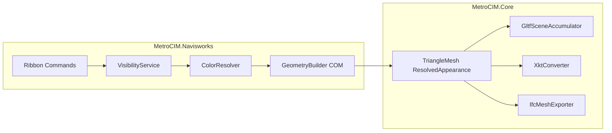

# Navisworks MetroCIM Add-in (same repo)

## Decisions locked
- **No new GitHub repo** — live in MetroCIM alongside the Revit add-in.
- **Years:** Navisworks Manage/Simulate **2025, 2026, 2027** (same span as Revit).
- **IFC:** Yes. Navisworks has no Revit IFC setup UI, so MetroCIM will **write IFC4 from the same colored triangle meshes** used for glTF (tessellated `IfcTriangulatedFaceSet` + surface styles). Same ribbon button and on-screen colors; no Revit setup picker.
- **Compile refs:** `Speckle.Navisworks.API` NuGet (`2025.0.0` / `2026.0.1` / `2027.0.0`) — Navisworks is not installed on this machine.
- **TFM:** `net48` (required by Navisworks .NET API).

## Feature parity

| Feature | Revit today | Navisworks |
| --- | --- | --- |
| Ribbon tab **MetroCIM** / panel **Export** | Yes | Yes |
| Export glTF | View-visible colored meshes | Same via NW geometry + overrides |
| Export XKT | glTF + metadata + xeokit-convert | Same CLI path |
| Export IFC | Revit `Document.Export` + patch | MetroCIM IFC4 mesh writer + colors |
| Visibility | View filters / hide / worksets | Hidden items, hidden in current view, empty geometry skipped |
| Colors | Filter → override → MEP → material | Override → fragment appearance → category/property color → default |

## Architecture



### 1. Extract portable core — `src/MetroCIM.Core/`
New `netstandard2.0` library so Revit (`net8`/`net10`) and Navisworks (`net48`) can share writers:
- Move/adapt host-free types from Revit: `ResolvedAppearance`, `TriangleMesh`, `GltfSceneAccumulator` / save helpers, `XktConverter`, progress-agnostic path helpers.
- Add **`IfcMeshExporter`**: write IFC4 STEP from color-batched meshes (products + `IfcTriangulatedFaceSet` + `IfcColourRgb` / `IfcStyledItem`). This is the Navisworks **Export IFC** implementation.
- Keep Revit project compiling by referencing Core and deleting duplicated files (or thin wrappers).

### 2. Navisworks host — `src/MetroCIM.Navisworks/`
Multi-version via `-p:NavisworksVersion=2025|2026|2027` (default 2027), similar to [Directory.Build.props](../../Directory.Build.props):
- `Speckle.Navisworks.API` matching year; `ExcludeAssets=runtime`.
- Entry: managed plugins + ribbon (tab **MetroCIM**, three commands).
- **`VisibilityService`:** walk `Document.Models` / descendants; skip hidden / hidden-from-view / non-geometry.
- **`ColorResolver`:** item override color → COM fragment appearance (diffuse) → useful property colors when present → neutral default. Map MEP-like properties (`System Type`, `System Name`, etc.) when present on items.
- **`GeometryBuilder`:** COM `GenerateSimplePrimitives(eNORMAL | eCOLOR)` via `ComApiBridge`; transform to meters + glTF Y-up; build `TriangleMesh`.
- **`DocumentExporter`:** orchestrate like [ViewExporter.cs](../../src/MetroCIM/Services/ViewExporter.cs) — visible items → color → mesh → Core writers.
- **`MetadataExporter`:** xeokit `metadata.json` from Navisworks property categories.
- Shared WinForms save/progress UI patterns (no Revit `TaskDialog`).

### 3. Packaging / install
Deploy target writes Autodesk ApplicationPlugins bundle (not Revit `.addin`):

```text
%AppData%\Autodesk\ApplicationPlugins\MetroCIM.Navisworks.bundle\
  PackageContents.xml
  Contents\2025\MetroCIM.Navisworks.dll
  Contents\2026\...
  Contents\2027\...
```

`PackageContents.xml`: `Platform="NAVMAN|NAVSIM"`, SeriesMin/Max `Nw22`/`Nw23`/`Nw24` for 2025/2026/2027, `AppType="ManagedPlugin"`.

Build: `dotnet build ... -p:NavisworksVersion=2027 -p:DeployAddin=true`.

### 4. Tests + docs
- Core unit tests for `IfcMeshExporter` (minimal STEP with one colored face set) and existing portable tests moved with Core.
- Update [README.md](../../README.md), [01-overview.md](01-overview.md), [02-architecture.md](02-architecture.md), [03-tasks.md](03-tasks.md), and [MetroCIM.slnx](../../MetroCIM.slnx).

## Out of scope / honest limits
- No Revit IFC setup picker or `Document.Export` parity.
- Freedom/Viewer not supported (no plugins).
- Requires Navisworks Manage or Simulate to **run**; build uses NuGet API stubs only.
- First version exports the **whole visible model** (not a Revit “active 3D view”); selection-only export can follow later if needed.

## Implementation order
1. Create `MetroCIM.Core` and move shared writers; keep Revit green.
2. Scaffold `MetroCIM.Navisworks` + bundle + multi-year props.
3. Implement visibility / color / COM geometry / document exporter.
4. Wire Export glTF + XKT.
5. Implement `IfcMeshExporter` and Export IFC.
6. Tests, README/rules, deploy script, build all three years.
