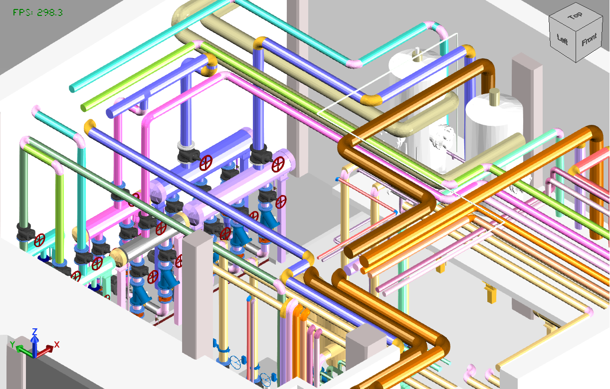

# MetroCIM

Export **visible 3D geometry** to **glTF**, **XKT**, and **IFC** with the colors you see on screen, plus **visible instance parameters** to **Excel**.

Hosts:

- **Autodesk Revit 2025 / 2026 / 2027**
- **Autodesk Navisworks Manage / Simulate 2025 / 2026 / 2027**

Agent/project rules: [rules/](rules/) (`01-overview`, `02-architecture`, `03-tasks`).



*Sample export of a mechanical room. Pipes, fittings, and accessories keep system colors.*

## What it exports

Both hosts use a **MetroCIM** ribbon tab with an **Export** panel:

| Command | Output |
| --- | --- |
| **Export glTF** | `.glb` / `.gltf` |
| **Export XKT** | `.xkt` (sibling `.glb` + `metadata.json`, then xeokit-convert) |
| **Export IFC** | `.ifc` |
| **Export Excel** | `.xlsx` (visible instances: Revit Id, IFC GUID, all instance/type or NW property values) |

### Revit
- glTF / XKT: active **3D view** visibility and colors (filters, overrides, MEP system types)
- glTF / XKT: choose **Local location** (Project Base Point) or **Shared Coordination** before save
- IFC: selected Revit IFC setup, then MetroCIM color apply + STEP patch (coordinates come from the IFC setup, not the Local/Shared prompt)
- Excel: view-visible instances → Revit Id, IFC GUID, all instance and type parameters

### Navisworks
- glTF / XKT / IFC: all **visible** model items (not hidden)
- Choose **Local location** (primary model origin) or **Shared Coordination** (world / federated) before save (mesh exports only)
- Colors: fragment appearance, then color-like properties
- IFC: MetroCIM IFC4 mesh writer (`IfcTriangulatedFaceSet`) — Navisworks has no Revit IFC setup picker
- Excel: visible items → Revit Id / IFC GUID (from properties when present) + all NW property values

## Requirements

- Revit **or** Navisworks Manage/Simulate for the matching year
- For **Export XKT** only:
  - [Node.js](https://nodejs.org/)
  - `npm install -g @xeokit/xeokit-convert`

## Installers (separate per-user EXE)

Nullsoft (NSIS) installers — **no administrator permission**. They write only under `%AppData%`.

Prerequisite on the build machine: [NSIS](https://nsis.sourceforge.io/Download) (`winget install --id NSIS.NSIS -e`).

```powershell
powershell -NoProfile -ExecutionPolicy Bypass -File Export\installer\Build-RevitInstaller.ps1
powershell -NoProfile -ExecutionPolicy Bypass -File Export\installer\Build-NavisworksInstaller.ps1
```

Outputs:

- `dist\MetroCIM-Revit-1.0.0.exe` — quit Revit, run the EXE
- `dist\MetroCIM-Navisworks-1.0.0.exe` — quit Navisworks, run the EXE

Uninstall from Windows **Settings → Apps** (per-user entry) or run the uninstaller under `%AppData%\MetroCIM\...`.

### Developer deploy (optional)

Copy straight into AppData from a local build:

```bat
dotnet build Export/Revit/MetroCIM.csproj -p:DeployAddin=true
dotnet build Export/Revit/MetroCIM.csproj -p:RevitVersion=2026 -p:DeployAddin=true
dotnet build Export/Revit/MetroCIM.csproj -p:RevitVersion=2025 -p:DeployAddin=true

dotnet build Export/Navisworks/MetroCIM.Navisworks.csproj -p:DeployAddin=true
dotnet build Export/Navisworks/MetroCIM.Navisworks.csproj -p:NavisworksVersion=2026 -p:DeployAddin=true
dotnet build Export/Navisworks/MetroCIM.Navisworks.csproj -p:NavisworksVersion=2025 -p:DeployAddin=true
```

Install locations:

- Revit: `%AppData%\Autodesk\Revit\Addins\<year>\`
- Navisworks: `%AppData%\Autodesk\ApplicationPlugins\MetroCIM.Navisworks.bundle\`

## Layout

```text
Export/
  Core/         shared writers (glTF, XKT, IFC mesh, Excel)
  Revit/        Revit add-in
  Navisworks/   Navisworks add-in
  Tests/        unit tests
  installer/    per-user NSIS EXE builders
  docs/         sample images and docs assets
  rules/        project rules and plans
  README.md     MetroCIM.slnx  Directory.Build.props  LICENSE  global.json
```

## Build

```bat
dotnet build Export/Core/MetroCIM.Core.csproj
dotnet build Export/Revit/MetroCIM.csproj
dotnet build Export/Navisworks/MetroCIM.Navisworks.csproj
dotnet test Export/Tests/MetroCIM.Tests.csproj
```

| Host | TFM | API |
| --- | --- | --- |
| Shared Core | `netstandard2.0` | SharpGLTF + writers |
| Revit 2027 | `net10.0-windows` | Nice3point `2027.*` |
| Revit 2025/2026 | `net8.0-windows` | Nice3point year packages |
| Navisworks 2025–2027 | `net48` | Speckle.Navisworks.API |

## Repository

https://github.com/metrocimcity-jpg/MetroCIM
